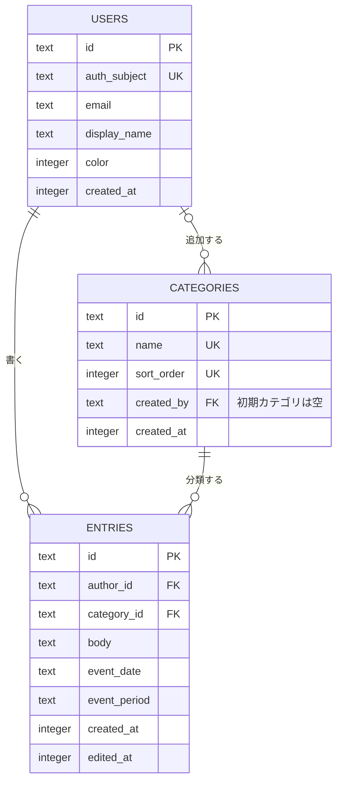

# データモデル

1つの設置先を、家族の1つの共有スペースとして扱う。Cloudflare Accessで許可された利用者は、同じ記録とカテゴリを見られる。SQLiteに保存し、実装ではDrizzleのスキーマとマイグレーションSQLに、ここに示す制約を反映する。

## 決め方

| 項目 | 決めたこと |
|---|---|
| ID | アプリで `crypto.randomUUID()` を生成し、文字列で保存する |
| 記録した日時 | UTCのミリ秒（整数）で保存し、表示時に `TZ`（既定は `Asia/Tokyo`）へ変換する |
| 出来事の日付 | タイムゾーンに依存しない暦日として `YYYY-MM-DD` の文字列で保存する |
| 利用者の識別 | アプリ内IDを固定し、Cloudflare AccessのJWTの `sub` で認証情報と照合する |
| 共有範囲 | Accessで許可された利用者全員が、すべての記録とカテゴリを見られる |
| 制限 | 本文1〜10,000文字、表示名1〜20文字、カテゴリ名1〜20文字。空白だけの値は拒否する |

## ER図



`users` は実際にログインした利用者の記録であり、Cloudflare Accessの許可リストそのものではない。アクセスを外された人の記録と表示名は残す。現行版には作成者・グループ・対象者・招待のテーブルを持たない。

## SQL

```sql
PRAGMA foreign_keys = ON;

-- 空白とみなす文字: タブ・改行・VT・FF・CR・半角スペース・NBSP・全角スペース
-- char(9,10,11,12,13,32,160,12288)
CREATE TABLE users (
  id           TEXT    NOT NULL PRIMARY KEY,
  auth_subject TEXT    NOT NULL UNIQUE CHECK (length(auth_subject) > 0),
  email        TEXT    NOT NULL CHECK (length(email) > 0 AND email = lower(email)),
  display_name TEXT    NOT NULL CHECK (length(trim(display_name, char(9,10,11,12,13,32,160,12288))) >= 1 AND length(display_name) <= 20),
  color        INTEGER NOT NULL CHECK (color BETWEEN 0 AND 5),
  created_at   INTEGER NOT NULL
);

CREATE TABLE categories (
  id         TEXT    NOT NULL PRIMARY KEY,
  name       TEXT    NOT NULL UNIQUE CHECK (name = trim(name, char(9,10,11,12,13,32,160,12288)) AND length(name) BETWEEN 1 AND 20),
  sort_order INTEGER NOT NULL UNIQUE CHECK (sort_order >= 0),
  created_by TEXT    REFERENCES users(id) ON DELETE RESTRICT,
  created_at INTEGER NOT NULL
);

CREATE TABLE entries (
  id           TEXT    NOT NULL PRIMARY KEY,
  author_id    TEXT    NOT NULL REFERENCES users(id) ON DELETE RESTRICT,
  category_id  TEXT    NOT NULL REFERENCES categories(id) ON DELETE RESTRICT,
  body         TEXT    NOT NULL CHECK (length(trim(body, char(9,10,11,12,13,32,160,12288))) >= 1 AND length(body) <= 10000),
  event_date   TEXT    NOT NULL CHECK (event_date GLOB '[0-9][0-9][0-9][0-9]-[0-9][0-9]-[0-9][0-9]' AND date(event_date, '+0 days') IS event_date),
  event_period TEXT    CHECK (event_period IN ('morning', 'afternoon', 'evening', 'night')),
  created_at   INTEGER NOT NULL,
  edited_at    INTEGER
);
CREATE INDEX entries_by_event_date ON entries (event_date DESC, created_at DESC, id DESC);
```

## データと権限

- Accessが許可した認証済み利用者だけがアプリを利用できる。アプリもJWTの署名・発行者・対象・期限を検証する。未認証・無効なリクエストは拒否し、本文をログへ出さない。
- 現行版はCloudflare Accessの発行元を1つに固定する。検証済みJWTの空でない `sub` を `auth_subject` と照合し、空の `sub` やメールアドレスのないリクエストは拒否する。メールアドレスは認証情報の表示用であり、本人の照合には使わない。
- `auth_subject` が一致する利用者のメールアドレスが変わった場合は、検証済みの値を小文字にして更新する。一致しない場合は新規利用者を作るが、同じメールアドレスが既存ユーザーにある場合は自動で紐付けず、運用者の確認を求める。
- Cloudflare Accessの `sub` はユーザーをZero Trust組織から削除して再追加した場合や別組織に移る場合などに変わり得る。変更時は運用者が本人と既存ユーザーを確認し、新しい `sub` の一意性を確認したうえで `auth_subject` を更新する。`id` は変更せず、記録と編集権限を引き継ぐ。メールアドレスの一致だけで自動統合しない。
- 初回登録時の表示名はメールアドレスのユーザー名部分とし、20文字以内の有効な値にする。名前は後から変更でき、過去の記録にも反映される。
- `color` は利用者の登録順で0〜5を繰り返し、一度決めたら変更しない。色は本人の区別の補助であり、名前と頭文字も表示する。
- 最初の起動時、初期カテゴリ `物忘れ`、`思い込み`、`その他` を順に作り、`sort_order` を0、1、2にする。初期カテゴリの `created_by` は `NULL`。初期化はトランザクション内で行い、再起動で重複させない。
- 追加カテゴリの名前は保存前に前後の空白を除去する。既存と同名なら追加しない。`sort_order` は同一トランザクションで最大値の次を割り当て、表示順とグラフの色を安定させる。色は `sort_order` を6で割った余りに対応する。
- すべての記録は認証済み利用者が読める。追加は認証済み利用者が行い、`author_id` は検証済みの本人のIDをサーバー側で入れる。編集と物理削除は、`author_id = :me` を条件にする。`created_at` は変更せず、編集時に `edited_at` を入れる。
- Accessの許可を外した人は再認証後アクセスできないが、DB上の利用者と記録は残す。Accessのセッションや失効の扱いはCloudflare側で設定・確認する。ユーザー削除機能は現行版に含めない。
- `last_seen_at` は持たない。書きかけはサーバーではなく端末にだけ残す。
- 出来事の日付は形式と実在日をDBで検査し、未来の日付はアプリ側で拒否する。時間帯は朝・昼・夕方・夜または未指定とする。

## 接続と操作

接続直後、トランザクションの外で `foreign_keys = ON`、`journal_mode = WAL`、`busy_timeout = 5000` を設定する。外部キー設定は接続ごとに必要。書き込みを伴う処理は1トランザクションで行い、`BEGIN IMMEDIATE`（`better-sqlite3` の `.immediate()`）を使う。

一覧は出来事の日付を両端含む範囲で絞り、同じ日付は記録した日時、同時刻ならIDで安定して並べる。古い順では3つの並びをすべて `ASC` にする。

```sql
SELECT e.id, e.body, e.event_date, e.event_period, c.name AS category,
       e.created_at, e.edited_at, u.display_name, u.color
FROM entries e
JOIN categories c ON c.id = e.category_id
JOIN users u ON u.id = e.author_id
WHERE e.event_date >= :from_date AND e.event_date <= :to_date
ORDER BY e.event_date DESC, e.created_at DESC, e.id DESC;
```

まとめは同じ `entries` を出来事の月とカテゴリで集計する。結果には解釈や診断を加えない。初期・追加カテゴリは件数0でも表示できるよう、カテゴリ一覧を基準に扱う。

## 実装時の検証

- マイグレーションSQLに、外部キー・一意制約・`CHECK`・索引が反映され、接続ごとに外部キーが有効になる。
- 未認証の読み書きは拒否し、認証済み利用者は全記録を読める。他人の記録の編集・削除は拒否する。
- JWTの空の `sub` と不正な発行元を拒否し、同じ `sub` の重複登録を防ぐ。`sub` 変更時は本人確認なしで既存アカウントに紐付けず、確認後の変更で記録者IDと権限が維持される。
- カテゴリ初期化を繰り返しても重複せず、追加名の重複・空白のみ・前後空白を拒否する。
- 存在しない記録者・カテゴリ、全角空白だけの本文、文字数超過、不正な暦日・時間帯を拒否する。
- うるう日・期間の両端・同一日時の並び、月別・カテゴリ別の0件を含む集計を確認する。
- 参照される利用者とカテゴリは削除できず、記録の物理削除後も整合性が保たれる。Accessの許可を外しても過去の記録は残る。

将来のデータモデル拡張は [roadmap.md](roadmap.md) にまとめる。
