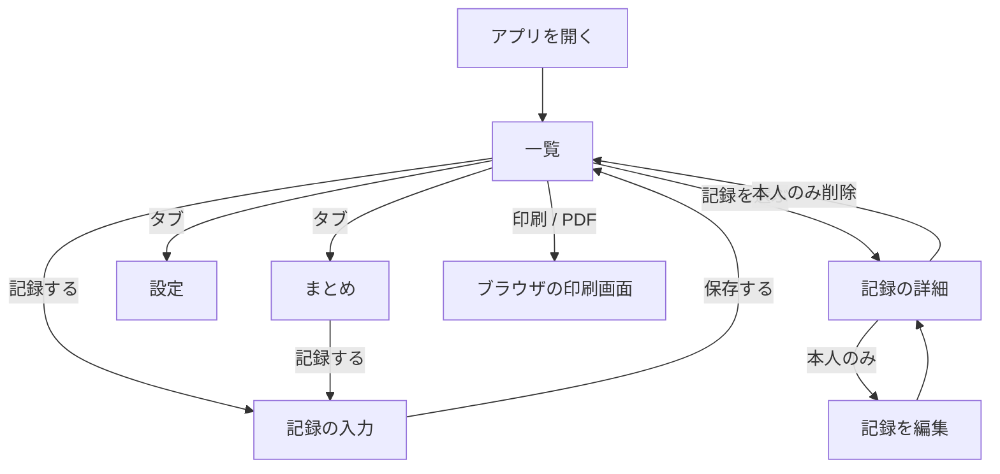

# 画面設計

`spec.md` の仕様を画面にしたもの。スマホを中心に、年齢や利用環境を限定せず、誰でも使いやすいことを重視する。

## 方針

- 1つの設置先を家族の共有スペースとし、Cloudflare Accessで許可された人は過去を含むすべての記録を見られる。グループの選択・作成や招待は現行版に含めない。
- 本人を見張る道具に見せない。警告色、点数、評価バッジは使わず、月別・カテゴリ別の件数にも解釈を加えない。
- 一覧とまとめの右下に「記録する」を置く。記録時は出来事の日付・任意の時間帯・カテゴリと本文を入力する。
- 「異常」「問題」「悪化」「疑い」のような判定の言葉は使わない。現行版にAIを入れない。
- 一覧は印刷やPDFにも使い、紙で全文を読めるようにする。

### 読みやすさと操作

- 押せる部分は高さ44px以上、主なボタンは52pxを目安にする。本文は17px、最小14pxを目安に `rem` を使い、文字サイズの設定に従う。行間は1.5倍以上。
- 文字は背景とのコントラスト比4.5:1以上、入力欄や操作部品の枠は3:1以上を目安とする。色だけに頼らず、文字・形・選択状態も併用する。
- キーボード操作とフォーカス表示、スクリーンリーダー向けの名前、スマホ・PC、ダークモードに配慮する。アイコンには文字ラベルを添える。
- 入力の保存ボタンは画面下に置く。戻る・キャンセルと削除を明示し、削除には確認を挟む。

### 見た目

- 緑がかった薄いグレーの背景と白いカードを使い、選択・操作には落ち着いた緑を使う。
- まとめのカテゴリ色は青 `#5B9CC0`、コーラル `#D8876B`、黄土 `#D3A252` を基調とし、色に評価や重要度の意味を持たせない。カテゴリ名と件数も示す。
- 書いた人の頭文字アイコンにも調和する色を使うが、カテゴリとは関係づけない。同じ人は同じ色とし、名前・頭文字も併記する。色が重なっても区別できるようにする。
- 印刷では白黒でも読めるようにする。線のアイコンを使い、文字の太さは通常と太字を基本とする。

## 画面遷移

一覧・まとめ・設定は、アイコンと文字付きの下部3タブで行き来する。入力・詳細・編集にはタブバーを出さず、戻る・キャンセルを左上に置く。グループ切り替えや招待、メンバー管理は置かない。利用許可は運用者がCloudflare Access側で管理する。

## 各画面

### 一覧

- 起動時に一覧を開く。日付ごとに記録をまとめ、カテゴリ・任意の時間帯・書いた人・記録時刻・本文を表示する。本文は3行で省略し、詳細から全文を読める。
- 初期期間は直近1か月。直近1週間・1か月・3か月・すべて、または日付指定を選べる。新しい順／古い順を切り替える。
- 期間・並び順・印刷/PDFは一覧上部にまとめる。記録が0件のときはそれらを出さず、最初の記録を促す。
- 印刷では現在の期間と順序のまま全文を出し、アプリ名・期間・件数・並び順・出力日を示す。記録の途中でページが切れないよう配慮する。
- 「記録する」はタブバーの上に固定し、スクロールしても同じ位置に表示する。

### まとめ

- 月ごとの件数はカテゴリ別の積み上げ棒グラフと数値で3か月ずつ表示し、前後3か月へ切り替える。灰色の補助棒は出さない。
- カテゴリごとの件数は横棒と数値で、別に選択した1か月を表示する。先月・翌月の切り替えは月別グラフと連動させない。
- 凡例は色とカテゴリ名を併記する。件数は事実として表示し、増減の評価・警告・予測は出さない。
- 一覧と同じ位置に「記録する」を置く。記録が0件でも入力を始められる。

### 記録の入力・詳細・編集

- 入力は出来事の日付（必須、初期値は当日）、朝・昼・夕方・夜（任意）、カテゴリ（必須）、本文の順。カテゴリは文字ボタンで選び、選択中は緑で塗る。丸いラジオボタンは出さない。
- 初期カテゴリは `物忘れ`・`思い込み`・`その他`。必要なら「＋ 新しいカテゴリ」から追加でき、許可された全利用者で共有する。
- 日付・カテゴリ・本文が未入力なら保存できない。書きかけは端末に残し、保存・キャンセル・ログアウトで消す。
- 詳細では出来事の日付・時間帯・カテゴリ、本文、書いた人、記録した日時を区別して表示する。編集した場合は「編集済み」と編集日時も示す。
- 編集・削除は書いた本人だけに表示し、サーバー側でも権限を確認する。削除は本文から離して置き、「削除すると、元に戻せません」と確認する。
- 保存・更新・削除に成功したら、移動先の画面の上部に「記録を保存しました」「記録を更新しました」「記録を削除しました」を一度だけ出す。アプリの幅の中、ヘッダー直下に固定して表示し、スクロールしても見える。`role="status"` の領域に出し、下の操作は妨げない。JavaScript が動くときだけ、表示から 4 秒後にフェードアウトして消える（`prefers-reduced-motion` では動きなしで消す）。JavaScript がなくても表示し、その場合は次の画面に移るまで残る。右端の「閉じる」は同じ画面（検索条件つき）への普通のリンクで、JavaScript がなくても読み直して通知だけを消せる。JavaScript があるときは、移動せずその場で閉じる。「閉じる」は読み上げの領域に含めない。失敗したときは通知を出さず、従来のエラー表示を使う。

### 設定

- 自分の表示名、メールアドレス、ログアウトを表示する。表示名は変更でき、過去の記録にも反映される。メールアドレスは表示のみ。
- アカウント削除、共有相手の追加・停止、招待リンクの発行は現行版の画面に置かない。

現行版に含めない機能と、その画面設計の方針は [roadmap.md](roadmap.md) にまとめる。
