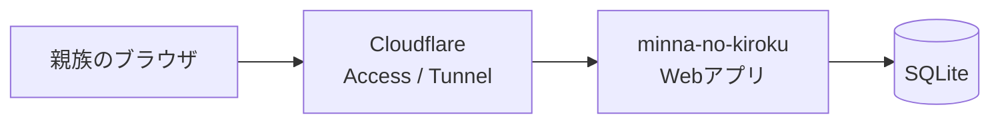

# 技術方針

`product.md` の内容を実現するための技術方針。

## 前提

- Web アプリとして作る。
- 認証は、Cloudflare Access の SSO。
- 1 つの設置先を 1 つの家族の共有スペースとし、アクセスを許可された人は全記録を見られる。招待や複数グループの管理は現行版に含めない。
- Docker で起動し、自宅サーバーで運用する。
- AI は現行版では使わない。将来の機能は [roadmap.md](roadmap.md) にまとめる。

## 全体構成

自宅サーバーの Docker で動かし、外への公開は Cloudflare Tunnel を通す。ルーターのポート開放は要らない。

## 認証

- Cloudflare Access（Zero Trust）で SSO する。IdP（Google など）は、Cloudflare 側で設定する。
- アプリは、Access が付ける `Cf-Access-Jwt-Assertion` ヘッダーの JWT を検証して、ユーザーを識別する。
  - 署名の検証には、Cloudflare の公開鍵（JWKS）を使う。`aud`、`iss`、有効期限も確認する。
  - ヘッダーを検証せずに信用してはいけない。Tunnel を迂回されると、偽装できてしまうため。
  - 検証は `jose` ライブラリで行う（公式の例がある）。フレームワークのミドルウェアで 1 回行うだけでなく、データを扱う側でも、ユーザーを確かめる。
- 現行版はAccessの発行元を1つに固定し、検証済みJWTの空でない `sub` を `users.auth_subject` に照合する。メールアドレスは表示用に保存し、本人の照合には使わない。記録はアプリ内の固定ユーザーIDに結びつける。
- `sub` が変わった場合は運用者が本人を確認して `auth_subject` を更新し、アプリ内IDと過去の記録を引き継ぐ。同じメールアドレスでも自動統合しない。詳細は [data-model.md](data-model.md)。
- 表示名（`display_name`）は、初回のログインで、メールアドレスのユーザー名の部分を入れる。設定画面で変更できる。記録は `author_id`（ユーザー）に結びつけ、名前は表示するときに引く。名前を変えると、過去の記録の表示も変わる。
- ログアウトは、Cloudflare Access のログアウト URL（`/cdn-cgi/access/logout`）へ移動させる。アプリには、パスワードやセッションの仕組みを持たせない。
- 本番では Cloudflare Access を、ローカル開発では固定ユーザーを使う。本番ビルドで開発用認証は無効にする。
- アクセス権の追加・削除は Cloudflare 側で管理する。削除時は既存セッションの扱いも確認し、必要に応じて失効させる。アクセスを失っても、その人が書いた記録は残る。

## 技術スタック

| 領域 | 選定 | 理由 |
|---|---|---|
| 言語 | TypeScript | フロントとバックを同じ言語で書ける |
| フレームワーク | SvelteKit（`adapter-node`） | 小さく、必要な機能だけで足りる。理由は後述 |
| UI | Svelte と CSS | UI コンポーネントライブラリに依存せず、誰にとっても使いやすい画面を作る |
| DB | SQLite（`better-sqlite3`） | 自宅サーバー 1 台の運用に向き、構成が軽い |
| ORM | Drizzle | 軽量で、型が安全 |
| テスト | Vitest / Playwright | ロジックと画面操作をそれぞれ検証する |

### フレームワークの選定

SvelteKit（`adapter-node`）を採用する理由と、見送った選択肢は [ADR 0001](adr/0001-web-framework.md) にまとめる。

### 脆弱性への備え

- 依存パッケージは、バージョンを固定し、更新を自動で知らせる仕組み（Dependabot か Renovate）を入れる。
- セキュリティの更新は、見つけたらすぐ適用する。公開の前に、月 1 回は確認する手順を決める。
- フレームワークのミドルウェア（`hooks`）だけに、認証を任せない。データを読み書きする関数の側でも認証済みユーザーを確認し、編集・削除時は記録者本人か確認する。
- リクエスト本文の大きさに上限をつける（`BODY_SIZE_LIMIT`）。
- 成功通知は、URL のクエリではなく、短命（60 秒）・`HttpOnly`・`SameSite=Strict` のフラッシュ Cookie（`flash`）で渡す。値は種別（`saved` / `updated` / `deleted`）だけで、文言は常にサーバーの表から引く。共通レイアウトの `load` が読んで直ちに消し（表示の自動消去はクライアントの任意の強化で、Cookie の寿命とは関係しない）、未知の値は表示しない。記録の本文や個人の情報は入れない。
- コンテナは、root で動かさない。書き込めるのは、データ用のボリュームだけにする。
- アプリは、Tunnel 経由でしか届かない状態にする。Cloudflare Access を迂回できる口を、作らない。

### SQLite の使い方

- 接続を開いた直後に、`foreign_keys = ON`、`journal_mode = WAL`、`busy_timeout`（5 秒）を設定する。外部キーは接続ごとの設定なので、毎回必要。
- 書き込みを含むトランザクションは、`BEGIN IMMEDIATE`（`better-sqlite3` では `.immediate()`）で始める。詳しくは [data-model.md](data-model.md) の「接続と操作」。
- テーブルの制約はDrizzleスキーマとSQLの両方に反映する。SQLはアプリに含め、`schema_migrations` に適用履歴を残すランナーで適用する。スキーマを変更するときは両方を更新し、テストする。
- DBファイルのパスは `DATABASE_PATH` で変更できる。既定は `./data/app.db`、Dockerでは `/app/data/app.db`。
- 現行版は 1 設置先につき 1 家族の共有スペースを想定し、書き込み頻度も低い見込み。
- 次のときは、PostgreSQL への移行を考える。
  - アプリを、複数のコンテナ（複数のサーバー）に分けたい。
  - DB のファイルを、NFS などのネットワークストレージに置きたい。
  - 長いトランザクションが必要になった。
- 移行しやすいように、ORM を挟んで、DB への依存を一か所にまとめる。

## デプロイ

- `Dockerfile`（マルチステージビルド）と `docker-compose.yml` を用意する。
- compose には、アプリと `cloudflared`（Tunnel）を入れる。
- SQLite のファイルは、ボリュームに置いて残す。
- 設定は、すべて環境変数で渡す。`.env.example` を用意する。
- 表示に使うタイムゾーンも、環境変数で指定する（既定は `Asia/Tokyo`）。
- バックアップは SQLite のバックアップ API など、WAL を含めて整合性を保てる方法を使う。稼働中の DB ファイルだけを単純コピーしない。定期取得と復元確認の手順を用意する。

## データモデル

テーブルの設計は、[data-model.md](data-model.md) にまとめた。

要点は次のとおり。

- テーブルは、`users`、`categories`、`entries` の 3 つ。カテゴリと記録は共有スペース内で共有する。
- 記録は、出来事の日付（`event_date`）と時間帯（`event_period`、省略できる）を持つ。記録した時刻（`created_at`）は、保存するときにシステムが入れる。編集したら `edited_at` を入れる。
- 記録者とカテゴリを外部キーで参照する。参照中のユーザーやカテゴリは削除しない。
- 編集・削除は記録者本人に限る。

将来の技術課題と機能追加は [roadmap.md](roadmap.md) にまとめる。
